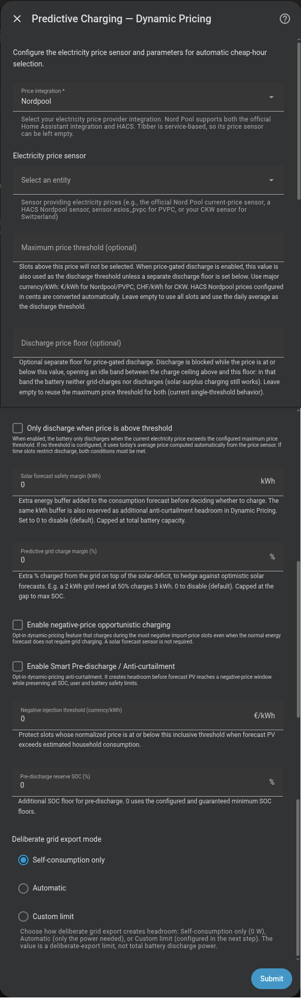

# Predictive charging with future prices

Dynamic Pricing reads a future price calendar and buys the calculated energy deficit in the cheapest periods that can still deliver it on time. It can also protect stored energy, manage solar export, and sell selected energy during expensive periods.

## Do I need it?

**Use it if** your provider publishes today’s and future interval prices and you want Omnibattery to choose when to charge.

**You do not need it if** your tariff has fixed repeating cheap periods; use [Time Slot](time-slot.md). If your source exposes only the price in effect now, use [Real-Time Price](real-time-price.md).

## Before you start

- Configure one supported source: **Nordpool**, **PVPC**, **CKW**, **EPEX Spot**, **ENTSO-e**, **EnergyZero**, **Zonneplan**, **Frank Energie**, **Tibber**, or **BE Electricity Prices** (Belgium).
- Select the provider’s current-price entity unless you use Tibber. EnergyZero uses the selected electricity entity to call `energyzero.get_energy_prices`; Tibber uses `tibber.get_prices` and needs no price sensor.
- A solar forecast is optional. A remaining-energy forecast improves daytime replanning and avoids counting solar already produced. **High-Price Sale** set to *Surplus only* or above needs the configured forecast integration to provide forecasts to Home Assistant’s Energy dashboard, such as Solcast or Forecast.Solar.
- Decide whether you need an export-price source. It is optional and is used by **Surplus Price Hold** and **High-Price Sale**; leave it empty when export is credited at the import price.

## How to enable it

1. Open **Settings → Devices & services → Omnibattery → Configure** and choose **Dynamic Pricing** as the predictive charging mode.
2. Select **Price integration type**, then choose **Electricity price sensor**. Leave the sensor empty for Tibber.
3. Select an optional solar forecast and, if required, an export/feed-in price sensor and its integration type.
4. Finish the form, then confirm **Predictive Charging** is on in the Omnibattery **Control** tab.
5. Leave the optional price controls off until the basic schedule behaves as expected; enable only the policy that matches your goal.

{ width="650" style="display: block; margin: 0 auto;" }

!!! note "Provider-specific sensor choice"
    For **BE Electricity Prices** (Belgium), choose its **Current price** sensor. It lists every slot of today and tomorrow at the all-in price for any contract, including time-of-use ones such as ENGIE Empower Flextime, so Dynamic Pricing works without a template. For the export curve, choose its **Injection price** sensor with the same type.
    For Zonneplan, choose **Current quarter hourly electricity tariff** for a quarter-hour contract or **Current hourly electricity tariff** for an hourly contract. The older **Current electricity tariff** sensor is also supported. For Nord Pool, choose either an official-integration entity or the HACS sensor; Omnibattery detects the format.

## What you will see

**Predictive Charging Active** shows whether charging is needed, the selected periods, their energy quotas, and any energy shortfall. Omnibattery chooses the cheapest eligible period that occurs before each projected need, so the absolute cheapest period can be skipped when it is too late.

A visible calendar can be informational. When stored energy and expected solar already cover demand, `selected_hours` may still show useful cheap periods while `charging_needed` remains false. Reaching a grid-charge target also leaves solar-surplus charging available; it does not lock the battery out of later solar.

The plan is rebuilt when new information changes the remaining horizon: before selected periods, late in the solar day, after a material SOC drop, after a material solar-forecast revision, when tomorrow’s prices arrive, when a relevant setting changes, or when an excluded large load changes how much forecast solar remains for the battery. Press **Re-evaluate Predictive Charging** to rebuild it immediately.

Optional controls in the **Control** tab solve different problems:

| Goal | Control | Result |
|---|---|---|
| Fill available battery space when import prices are negative | **Negative-price opportunistic charging** | Adds qualifying negative-price periods even without a normal energy deficit |
| Keep battery energy while the current price is cheap | **Price-Based Discharge** | Blocks ordinary discharge until price exceeds its active threshold |
| Avoid losing solar when export is penalized | **Smart Pre-discharge / Anti-curtailment** | Creates battery space before forecast solar-risk periods |
| Export solar now and absorb it later when feed-in value is lower | **Surplus Price Hold** | Pauses surplus charging outside selected low export-price periods |
| Save stored energy for dearer household-demand periods | The plan itself (no setting) | Holds the battery where the grid is cheaper than the battery's later use |
| Require a worthwhile buy/sell spread | **Minimum Arbitrage Margin** | Rejects charge or export trades whose spread does not cover losses and the selected margin |
| Sell solar-refillable energy during a qualifying price peak | **High-Price Sale** → *Surplus only* | Exports battery energy that tomorrow’s forecast solar can replace after covering the home until sunrise |
| Also sell energy the home needs later, and buy it back | **High-Price Sale** → *Surplus + arbitrage* | Exports energy only when replacing the household demand it gives up later still saves money |

## If it does not work

| Symptom | Likely cause | What to check |
|---|---|---|
| No schedule appears | Future prices are unavailable or the wrong provider entity was selected | `price_data_status`, provider integration, and price-sensor attributes |
| Cheap periods appear but no charge starts | The calendar is informational, no deficit remains, or the per-period quota is already met | `charging_needed`, `slot_energy_targets_kwh`, and battery target SOC |
| The cheapest period was skipped | It occurs after the energy deadline, exceeds the price ceiling, or fails the arbitrage margin | `energy_deadlines`, active price controls, and `total_shortfall_kwh` |
| The schedule reports a shortfall | Eligible periods cannot supply enough energy before it is needed | Price ceiling, charging power, battery capacity, phase and Maximum grid import limits |
| Tomorrow’s cheaper periods are missing | The provider has not published them or the active period is allowed to finish before replanning | Provider data and **Re-evaluate Predictive Charging** after publication |
| A price feature is enabled but inactive | Its required forecast, profile, export price, battery capacity, or grid reading is unavailable | The feature’s status binary sensor and reason attribute |
| Solar surplus exports unexpectedly | **Surplus Price Hold** selected a later, cheaper absorption period | **Surplus Price Hold Status** and its next release time |
| The battery will not discharge | **Price-Based Discharge**, a hold of the plan (**Discharge Reserve Status**), operating time slots, or another discharge blocker is active | **Integration Status**, feature status sensors, and [operating time slots](../time-slots.md) |
| **High-Price Sale** on *Surplus only* does not sell | Tomorrow’s solar forecast cannot refill the battery, the forecast integration does not supply Energy dashboard forecasts, or no profitable export period exists | **High-Price Sale Status**, its reason attribute, tomorrow’s solar forecast, and export prices |

??? "Advanced details"
    ### Price-source normalization

    Omnibattery supports **Nordpool**, **PVPC**, **CKW**, **EPEX Spot**, **ENTSO-e**, **EnergyZero**, **Zonneplan**, **Frank Energie**, **Tibber**, and **BE Electricity Prices**. Provider parsers normalize dated price periods into the same local schedule.

    Frank Energie needs the [Frank Energie HACS integration](https://github.com/HiDiHo01/home-assistant-frank_energie). It reads the chosen sensor’s `prices` attribute (`from`, `till`, `price`), including tomorrow when available. Prices are already tax-inclusive major currency/kWh and are not rescaled. Use the all-in price sensor for import, for example `sensor.frank_energie_electricity_prices_current_electricity_price_all_in`, and the including-tax-and-markup sensor for export, for example `sensor.frank_energie_electricity_prices_current_electricity_price_including_tax_and_markup`. Periods may be hourly or quarter-hourly.
    EnergyZero calls `energyzero.get_energy_prices` for today and tomorrow using the selected electricity sensor's integration entry, market/all-in price type, and hourly/quarter-hourly interval. Prices include VAT and are already in EUR/kWh; tomorrow is retained when published, while unavailable tomorrow data does not discard today's prices.

    Zonneplan reads the chosen sensor’s `forecast` attribute, including tomorrow when available. Forecast amounts are divided by 10,000,000 into tax-inclusive major currency/kWh; the current sensor state is already major currency/kWh. Negative and zero prices are preserved. Modern entries keep explicit period boundaries; legacy entries use one-hour periods.

    A Nord Pool HACS entity is read from `raw_today` and `raw_tomorrow`. If `price_in_cents` is true, Omnibattery converts the calendar and live price to major currency/kWh. For an official Nord Pool entity, it resolves the market area, calls `nordpool.get_prices_for_date`, converts currency/MWh to currency/kWh, and refreshes the cache hourly.

    Tibber calls `tibber.get_prices`, caches today’s prices and tomorrow’s once published, and refreshes the cache hourly. The official Tibber integration must already be configured.

    The planner uses local wall-clock times. During the autumn daylight saving time (DST) transition, repeated local periods cannot be represented separately; a period whose local end precedes its start is skipped. Review the schedule on clock-change days.

    ### Daily chronological plan

    At 00:05 local time, Omnibattery:

    1. Projects household consumption, solar, and usable battery energy in 15-minute intervals through the next local sunrise. Sunrise is bounded to 00:00–12:00; if it cannot be calculated, the horizon ends at midnight.
    2. Fetches the available price periods through that horizon.
    3. Detects when cumulative energy would reach minimum SOC and reserves the cheapest eligible periods that can deliver each requirement before its deadline.
    4. Calculates the daily average price over the available horizon.
    5. Gives each selected period an energy quota; only energy without an earlier deadline is optimized freely by price.

    “Cheapest” means cheapest among periods that can meet the requirement in time. The projection caps stored energy at usable fleet capacity, so solar that cannot fit is not carried forward as phantom energy. A partial plan remains executable but records whether price filtering or physical period capacity caused the uncovered kWh.

    Only today’s remaining solar enters the control horizon. Household demand after midnight is included through sunrise, when tomorrow’s production can begin. **Solar Forecast Safety Margin** is subtracted once from that forecast. It is a share of the forecast sun (default 10 %), so a partial day or a two-day horizon gives up its own share; with no solar forecast there is no margin. Anti-curtailment keeps that share of each negative-price slot's sun as extra room, as far as the battery can charge it in the slot. This is a live control rather than a setup-form field.

    If prices are missing at 00:05, evaluation is retried at 15-minute offsets during the first hour, for up to four retries. If Home Assistant starts after the daily evaluation and no plan exists, it rebuilds the remaining horizon after a 15-second startup delay.

    ### Automatic re-evaluation

    The daily plan can be rebuilt by these events:

    - **Before a selected period:** one hour before a future selected period, Omnibattery checks the remaining balance. It silently removes the period if energy is now sufficient or confirms it by notification when the deficit remains. Back-to-back periods are not reconsidered while the previous one is charging.
    - **Late-day assessment:** when solar start has been detected, this runs about 1.5 hours before estimated production ends; otherwise it uses 16:00. It rebuilds the remaining-horizon plan, exactly like the other rebuilds.
    - **SOC drop:** the plan rebuilds when the fleet SOC falls three percentage points below what it projected for the end of the current quarter, which also catches a planned charge that did not happen. Without a projection, a chronological plan rebuilds after a five-point drop from the last evaluated fleet average, and a fallback non-chronological plan after 30 points. An SOC rise does not trigger it.
    - **Solar forecast revision:** a change of at least 1.5 kWh in either direction rebuilds the plan, with a 30-minute cooldown and a maximum of four such rebuilds per day. Measured solar since the saved reading is removed before comparison, and an unavailable sensor is not treated as a collapsed forecast.
    - **Excluded-device solar claim:** a material change in an excluded load, such as an electric vehicle session, rebuilds the plan because that device changes how much forecast solar is available to the battery.
    - **Tomorrow’s prices:** newly published prices rebuild the remaining horizon once per day. If a selected charge period is running, this rebuild waits until it ends.
    - **Relevant settings:** changes to battery minimum/maximum SOC, **Solar Forecast Safety Margin**, or **Guaranteed Minimum SOC** rebuild the plan on the next control cycle.

    The daily references reset at midnight. Runtime protections, manual control, backup state, time-slot permissions, battery availability, and SOC limits remain authoritative during every rebuild.

    **Re-evaluate Predictive Charging** rebuilds the remaining Dynamic Pricing horizon immediately. It does not create a multi-day plan: an afternoon rebuild covers the remaining period through the next sunrise, while the next normal daily plan is built at 00:05.

    ### Negative-price opportunistic charging

    This opt-in feature independently selects hourly or quarter-hour import periods whose normalized price is below zero. It calculates the battery energy needed to reach each battery’s configured maximum SOC and takes the most negative periods first. A solar forecast is not required.

    Each selected period records `deficit`, `negative_price`, or `combined` as its purpose. A positive-price deficit period retains the normal deficit target. In a combined period, the higher of the deficit and opportunity targets applies. Charging stops at each battery’s configured maximum SOC, and unused opportunity-only periods are removed.

    During an anti-curtailment risk window, opportunity charging can use only battery space left after reserving room for expected solar:

    ```text
    opportunistic space = current free space − remaining solar reserve
    ```

    A guaranteed-minimum-SOC requirement is the safety exception. Missing solar data makes anti-curtailment fail safe but does not cancel an otherwise valid negative import-price opportunity. Maximum grid import, battery limits, manual control, backup state, availability, and other safety blockers still apply.

    ### Smart Pre-discharge / Anti-curtailment

    This opt-in feature does not control a solar inverter. It finds periods where the **export** price is at or below **Negative Feed-in Price Threshold** (the import price when no export price sensor is configured) and forecast solar surplus exceeds household consumption. Before the first risk period, it selects the most valuable eligible periods for pre-discharge until enough battery space exists, subject to SOC floors, reserves, power limits, and blockers.

    With an export price sensor, the Dynamic Pricing plan decides the pre-discharge itself, in the same plan as the grid charge and the other decisions: when to discharge and how much, up to tomorrow's sun when its prices are out. It makes only the space the risk's sun needs, counting what the home will use before the risk, never below the reserve, never inside a risk period and never at a battery export price at or below the threshold; it does not buy energy before a risk only to discharge it. In those periods the battery may also stop charging and let the solar surplus go to the grid, to keep that space free. The plan's notification lists these periods ("Making room for the sun"), and `curtailment_status` shows the plan's risk periods and discharge periods with `decided_by: plan`. Without an export price sensor the pre-discharge works as described below.

    The default negative-injection threshold is 0 currency/kWh. **Pre-discharge Lowest SOC** adds a floor; its default is 20%, while a value of 0 uses the batteries’ existing floors. Risk periods are grouped into approximately one-hour blocks to reduce repeated switching.

    Export is automatic: the battery may export up to the fleet's discharge power, only to create the calculated space.

    During a risk period, net grid target is clamped to zero so the battery can cover household consumption without deliberate export. Minimum and guaranteed-minimum SOC, operating time slots, manual control, backup state, unavailable batteries, and capacity protection still win. Missing prices, forecast, SOC, capacity, or grid data clears the override and blocker.

    `curtailment_status` reports state, reason, next risk period, required/current space, planned discharge, shortfall, battery targets, selected periods, and active export target. Automation attributes include `protected_window_active`, `headroom_deficit_kwh`, `inverter_curtailment_required`, `charge_limit_reason`, and `charge_limit_reasons`. Diagnostics also expose `solar_reserve_remaining_kwh`, `current_free_space_kwh`, and `opportunistic_space_available_kwh`.

    `active_export_target_w` is the battery’s target, not a universal solar-inverter command. An inverter automation must apply and later restore its own limit.

    ### Surplus Price Hold

    This opt-in feature decides when to absorb solar surplus under a dynamic export tariff. It estimates the battery’s remaining daily energy target, distributes expected solar and consumption across future price periods, and selects the lowest export-price periods that can absorb that target. A period with a low price but no available surplus is not selected merely because it is cheap.

    Outside selected periods it adds the `surplus_price_hold` charge blocker. Battery charging clamps to 0 W and surplus exports, while battery discharge for self-consumption remains available.

    The hold releases in a selected absorption period, after the solar deadline, once the target is met, when the remaining periods cannot cover the target, or when the best remaining saving is below **Surplus Hold Minimum Saving**. That control defaults to 0.02 currency/kWh. The target follows live SOC every cycle, and the plan is rebuilt every five minutes and during the normal Dynamic Pricing rebuilds.

    Missing prices, forecast, usable SOC/capacity, or finite inputs releases the hold. Charge delay, an active grid-charge period, negative-price charging, anti-curtailment, weekly full charge, peak shaving, electric-vehicle pause, manual control, operating-time ownership, and a battery on its SOC floor also release it.

    **Export/feed-in price sensor** is optional. When absent, the import curve is reused. Tibber cannot supply the export curve because its service cache belongs to the import source. A failed export sensor does not raise the import-price repair issue.

    **Surplus Price Hold Status** reports state, reason, daily target, remaining absorption capacity, deadline, next release, selected periods and their prices, and the curve source. **Integration Status** reports `surplus_price_hold` while active.

    ### Price-Based Discharge and separate discharge threshold

    **Price-Based Discharge** checks the current price every control cycle. If the price is above its threshold, normal PD discharge is allowed; at or below the threshold, discharge is blocked and controller state is frozen.

    Dynamic Pricing uses **Charge Price Ceiling** when configured; otherwise it uses the daily average calculated over the current planning horizon. If neither exists, this blocker does not act. The maximum threshold also prevents grid charging at prices above it.

    **Discharge Price Threshold** can open an idle price band. It must be at or above the charging ceiling:

    ```text
    price ≥ discharge threshold                   → discharge allowed
    charge ceiling < price < discharge threshold → neither grid charge nor discharge
    price ≤ charge ceiling                        → discharge blocked; cheap grid charge may run
    ```

    Leave the separate discharge threshold empty to use the maximum price threshold for both decisions. Solar-surplus charging remains available in the idle band. Operating time slots and price permission must both allow discharge; see [operating time slots](../time-slots.md).

    ### Holding the battery for a dearer hour

    The plan can hold the battery in a period: the grid carries the house there and the stored energy is kept for a dearer period later. It does so whenever the whole plan costs less, with the round-trip losses counted, and never on a tie; there is no switch and no minimum saving (#888). A held period can follow a charge in the same period, so energy bought there is not spent at the price it was bought at. Each new hold costs the planner 1 cent (never shown in the cost), so it does not alternate between holding and covering on small price differences.

    When the previous planner makes the plan (a fallback, see the planner's warning), nothing is held. Manual control, anti-curtailment, a manual slot and peak shaving release a hold; the grid import cap and emergency protection ignore it.

    **Discharge Reserve Status** is on while the plan holds a battery, with the held period (`held_slot`), where the run of held periods ends (`held_until`), the batteries held and the guard that released a hold (`release_reason`). **Integration Status** reports `price_reserve_hold` while a battery is held.

    ### Minimum Arbitrage Margin and round-trip efficiency

    The **Minimum Arbitrage Margin** rejects a charge period unless the expected future discharge value covers conversion losses and the selected margin:

    ```text
    expected_discharge_price × round_trip_efficiency − charge_price ≥ margin
    ```

    Empty or 0 means no profit on top of the losses: the round-trip efficiency alone decides. It applies in addition to **Charge Price Ceiling**, and the stricter ceiling wins. It gates the 00:05 plan and every later rebuild, including the late-day assessment. Energy needed for **Guaranteed Minimum SOC** is the exception: only **Charge Price Ceiling** limits it.

    `expected_discharge_price` is set per stored kWh, not for the whole deficit. The cheapest charge periods take the most expensive later periods, and each later period counts once. So the first kWh is compared with the evening peak, and the last with whatever cheaper hour it would replace. Energy the home needs at a given time is compared with the import price at that time. When importing then costs less than charging earlier with the round-trip losses, that energy is left to the grid and reported as `cheaper_to_import_kwh` instead of a shortfall. If no period qualifies, `chronological_plan_reason` is `price_threshold` and `cheapest_rejected_slot` shows the cheapest period with the ceiling it missed.

    **Round-Trip Efficiency** represents marginal AC-to-AC energy efficiency; lower values require a larger gross spread. Until you set a value, the integration uses the efficiency it measures on your batteries (capacity-weighted across the fleet), once a battery has enough history: at least 50 equivalent cycles with a lifetime ratio between 0.75 and 0.95, or, on Venus A/D, both charge and discharge legs sampled; the slider then shows that value, tagged *measured*. Without a valid measurement it uses 0.85. Moving the slider sets a fixed value that is always used as is, 0.85 included. To return to the measured value, tap the value on the card and choose **Use measured**, or call the `omnibattery.use_measured_round_trip_efficiency` action. Installations that had 0.85 stored keep using the measured value. The value in use and its source are shown as `round_trip_efficiency_used` and `round_trip_efficiency_source` on the predictive-charging diagnostics.

    The same minimum margin applies to **High-Price Sale**, so the charge and sell decisions use one economic risk preference.

    ### High-Price Sale

    One select, off by default and available only with **Dynamic Pricing**, sets how much stored energy may be sold into expensive export periods. Each level includes the one below it:

    - **Off**: nothing is sold.
    - **Surplus only**: sells energy the house will not need before sunrise and tomorrow’s solar can refill. It never makes you buy from the grid.
    - **Surplus + arbitrage**: also sells energy the house needs later, and buys it back from the grid when that is cheaper.

    #### Surplus + arbitrage

    This level also sells stored energy in a qualifying expensive period only when doing so still saves money after the household demand that energy would otherwise have covered is bought from the grid. Energy without later household demand is not sold, and export never crosses a battery’s SOC floor.

    When the forecast says the battery will run out before sunrise and the plan does not hold the battery (the previous planner made it), Omnibattery compares the export price with the last household-demand periods that would be bought back because of the sale. It starts with the latest period before sunrise and stops at the first sale that would not pay. For example, if the battery would last until 05:00, selling at 18:00 makes it run out a little earlier, around 04:00. What you buy back is the 04:00–05:00 demand, so the sale is compared with that price—not with the expensive 20:00 period the battery still covers.

    If the battery is forecast to last until sunrise, or the plan may hold it, the conservative rule remains: the export price must beat the highest later import price, plus **Minimum Arbitrage Margin**. The dearest qualifying export period receives energy first. Deliberate net-grid export uses the fleet’s effective discharge limit; there is no separate high-price export-cap control.

    #### Surplus only

    This level sells battery energy that the house will not need before tomorrow’s sunrise, but only when tomorrow’s forecast solar can refill it.

    Its export budget starts with usable battery energy, then keeps enough for forecast household consumption until sunrise, counting on the solar forecast less the **Solar Forecast Safety Margin**. The cost of selling is the export income given up tomorrow while solar refills the battery—not the price originally paid to charge it. It sells only when the current export price is higher than the highest export price expected during tomorrow’s refill, adjusted for **Round-Trip Efficiency** and **Minimum Arbitrage Margin**.

    With a flat feed-in tariff it never sells: selling now and refilling later would only lose energy in the battery cycle. It also stays inactive when tomorrow’s solar forecast cannot refill the battery. It uses tomorrow’s forecast from the solar forecast integration already configured in Omnibattery; no extra sensor is needed, but that integration must provide forecasts to Home Assistant’s Energy dashboard.

    The plan is rebuilt every five minutes and withdrawal is checked every control cycle. Missing price coverage, an expired period, anti-curtailment, capacity protection, weekly full charge, an active grid-charge period, manual control, operating-time ownership, an invalid grid meter, or any discharge blocker stops either export policy. Lowering the select removes the dropped policy on the next control cycle.

    **High-Price Sale Status** reports state, reason, target power, protected later demand, usable energy, allocated energy, and per-period allocations with their thresholds. Its surplus-export diagnostics include `trigger_1_budget_kwh`, `refill_price`, `trigger_1_reason`, `surplus_export_enabled`, and `surplus_kwh` for each period.

    ### Diagnostic attributes

    The `predictive_charging_active` binary sensor exposes:

    | Attribute | Meaning |
    |---|---|
    | `charging_needed` | Whether the remaining balance requires grid charging |
    | `selected_hours` | Selected periods and prices; can be informational when no charge is needed |
    | `average_price` | Average price over the evaluated profile |
    | `estimated_cost` | Estimated charging cost |
    | `evaluation_timestamp` | Time of the last evaluation |
    | `price_data_status` | Price source result such as `ok (N slots)`, `sensor_unavailable`, `no_slots`, or `not_evaluated` |
    | `chronological_planning_active` | Whether deadline-aware planning produced the schedule |
    | `chronological_source` / `solar_timeline_source` | Household-demand and solar timing sources |
    | `earliest_projected_depletion` | First projected minimum-SOC crossing without grid charging |
    | `deadline_required_kwh` / `flexible_required_kwh` | Energy tied to deadlines and energy optimized freely by price |
    | `deadline_shortfall_kwh` / `total_shortfall_kwh` | Urgent and total energy that eligible periods cannot deliver |
    | `energy_deadlines` | Cumulative requirements and local ISO deadlines |
    | `slot_energy_targets_kwh` / `slot_deadlines` | Per-period quotas and deadlines |
    | `energy_horizon_end` | Next-sunrise boundary, or midnight when sunrise cannot be calculated |
    | `planning_horizon_reason` | Why the plan did or did not extend past the next sunrise: `extended`, `no_price_slots`, `no_tomorrow_prices`, `solar_profile_off`, `no_tomorrow_solar_periods` (no dated forecast for tomorrow, from the sensor or the Energy dashboard), `no_consumption_profile`, or `daily_evaluation` |
    | `overnight_consumption_kwh` | Forecast household demand after midnight through the boundary |

    Notifications use the same planning boundary and show overnight demand separately. The dated solar timeline prefers provider periods, then a mature local solar profile, then a sinusoidal daylight curve; an invalid source falls back atomically to the next one.
