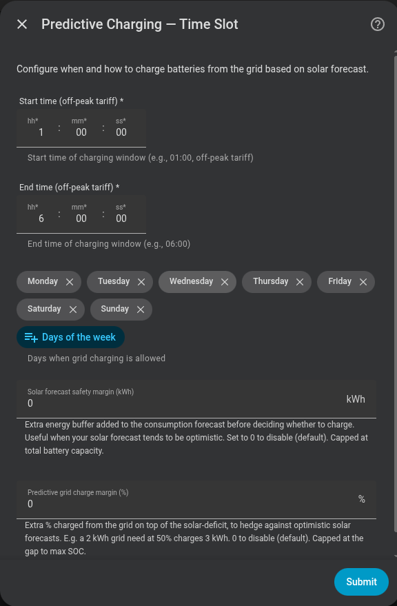

# Carga predictiva con franjas horarias fijas

El modo Franja horaria compra solo la energía que se espera que necesite tu vivienda durante las ventanas semanales baratas que definas. Nunca abre una ventana de carga no configurada.

## ¿Lo necesito?

**Úsalo si…** tu tarifa tiene periodos valle previsibles que se repiten en días conocidos, incluidas tarifas con periodos nocturnos y de mediodía separados.

**No lo necesitas si…** tu proveedor publica precios futuros cambiantes y quieres que Omnibattery elija los periodos más baratos; usa [Precio dinámico](dynamic-pricing.md). Si solo conoces el precio actual, usa [Precio en tiempo real](real-time-price.md).

## Antes de empezar

- Decide qué días y horas de inicio/fin son baratos. Puedes configurar hasta tres ventanas de carga predictiva.
- Un sensor de previsión solar es opcional. Prefiere un sensor de energía restante cuando esté disponible; se admite una previsión de todo el día como método alternativo.
- Configura los requisitos comunes de carga predictiva descritos en [¿Qué modo debo elegir?](index.md).

## Cómo activarlo

1. Abre **Ajustes → Dispositivos y servicios → Omnibattery → Configurar** y elige **Franja horaria** como modo de carga predictiva.
2. Introduce tanto la hora de inicio como la de fin de **Ventana de carga 1** y selecciona sus días activos.
3. Añade **Ventanas de carga 2 y 3** solo si tu tarifa tiene más periodos baratos; completa ambas horas en cada ventana que uses.
4. Selecciona un sensor opcional de previsión solar, termina el formulario y confirma que **Carga predictiva** está activada en la pestaña **Control** de Omnibattery.

{ width="650" style="display: block; margin: 0 auto;" }

## Qué verás

Al inicio de una ventana activa, Omnibattery comprueba el balance energético restante y asigna una cuota a esa ventana. Puede repartir la energía necesaria entre varias ventanas, de forma que la primera no consume automáticamente todo el objetivo diario flexible. La carga se detiene cuando se almacena la cuota o termina la ventana.

Dentro de una ventana, la red cubre la casa a precio barato, así que la batería guarda la energía que necesita para las horas posteriores a la ventana:

- **La ventana carga:** la batería carga su cuota y después se queda parada hasta que termina la ventana. Nunca carga para descargar en la misma ventana, porque solo perdería la ida y vuelta.
- **No hace falta cargar:** la batería descarga con normalidad, pero solo hasta la energía que necesita después de la ventana. A partir de ahí la red cubre la casa hasta que termina la ventana.

Por eso la cuota cubre solo la demanda posterior a la ventana, no el consumo de la casa durante ella. La [carga completa semanal](../../features/weekly-full-charge.md) mantiene su propio comportamiento.

**Carga predictiva activa** muestra la decisión y cualquier energía no cubierta. **Reevaluar carga predictiva** fuerza una decisión nueva en el siguiente ciclo de control mientras hay una ventana configurada activa. Fuera de una ventana, el botón invalida la referencia antigua para la siguiente ventana, pero no evalúa inmediatamente ni inicia carga.

El plan se adapta dentro de una ventana activa cuando el SOC cambia de forma importante, se cruza o recupera el suelo garantizado, el proveedor revisa la previsión solar, cambia un ajuste de batería o previsión relevante, o la [protección de capacidad](../../features/peak-shaving.md) modifica la potencia disponible para el plan.

## Si no funciona

| Síntoma | Causa probable | Qué comprobar |
|---|---|---|
| La carga nunca empieza | El día de hoy o la hora actual no coincide con una ventana completa configurada | Horas de inicio/fin, días activos y ventanas que cruzan medianoche |
| Aparece la ventana actual pero no hace falta carga | La energía de la batería y la solar prevista cubren la demanda restante | Atributos de decisión de **Carga predictiva activa** |
| Una previsión modificada no inicia carga a mediodía | No hay ninguna ventana de carga configurada abierta | Espera a la siguiente ventana o añade una ventana válida para tu tarifa |
| La primera ventana se detiene antes de alcanzar el objetivo diario completo | Se ha asignado energía a una ventana posterior | Cuota por ventana y ventanas seleccionadas restantes |
| El plan informa de un déficit no cubierto | Las ventanas configuradas o la potencia física de carga no pueden entregar suficiente energía antes de su plazo | Duración de ventana, límites de carga, capacidad de batería y bloqueos activos |
| La batería deja de descargar durante una ventana | Ha llegado a la energía que necesita después de la ventana; la red cubre la casa hasta que termina | `time_slot_floor_kwh` en **Carga predictiva activa** y el bloqueo de descarga `time_slot_floor_hold` |
| Pulsar reevaluar no hace nada | El botón se pulsó fuera de una ventana activa | Púlsalo durante una ventana configurada; fuera de ella prepara la siguiente entrada |

??? "Detalles avanzados"
    ### Evaluación y cuotas

    Al entrar en una ventana, Omnibattery evalúa inmediatamente cuando no hay previsión solar configurada o la previsión configurada es legible. Si la previsión no está disponible temporalmente, reintenta durante un periodo de gracia de cinco minutos; después evalúa de forma conservadora con solar cero.

    El planificador simula consumo, solar y energía utilizable de batería en intervalos de 15 minutos hasta medianoche. La energía necesaria antes de un cruce previsto del SOC mínimo se asigna solo a ventanas que pueden entregarla a tiempo. La energía posterior se distribuye entre las ventanas configuradas restantes. Si ninguna ventana puede cumplir un plazo, los kWh no cubiertos se informan como déficit no cubierto en vez de asignarse a una ventana demasiado tardía.

    Cada ventana recibe su propia cuota en kWh. La carga se detiene cuando la batería en vivo alcanza esa cuota o termina la ventana. Una cuota suspendida permanece vinculada al plan y se reconstruye desde el SOC en vivo cuando la carga puede continuar.

    ### Suelo de la ventana

    El planificador trata cada ventana configurada como un periodo con la batería parada: el consumo de la casa dentro de ella queda a cargo de la red y no forma parte de ninguna cuota. En cada evaluación la ventana recibe un suelo, la energía almacenada con la que debe terminar. Si la ventana carga, el suelo es la energía actual más la cuota. Si no, es la energía actual menos el punto más bajo de la proyección sin carga de red, es decir, la energía que sobra hasta la siguiente ventana. Mientras la energía almacenada esté en el suelo o por debajo, el bloqueo de descarga `time_slot_floor_hold` mantiene la batería parada. La protección de capacidad puede seguir descargando. El suelo se borra al terminar la ventana y no se usa durante una carga completa semanal.

    ### Disparadores de reevaluación

    Dentro de una ventana de carga activa, el balance se reconsidera cuando:

    - el SOC medio de la batería se mueve al menos 30 puntos porcentuales desde la última evaluación;
    - se cruza o recupera **SOC mínimo garantizado**;
    - el proveedor revisa la solar restante al menos 1,5 kWh en cualquier dirección;
    - cambian el SOC mínimo/máximo de batería, **Margen de seguridad de previsión solar** o el suelo garantizado; 
    - la protección de capacidad modifica si puede entregarse la carga planificada; o
    - pulsas **Reevaluar carga predictiva**.

    Las comprobaciones de revisión solar comparan la lectura nueva con una proyección que resta la solar ya producida, por lo que el descenso normal de una previsión de energía restante no parece una revisión del proveedor. Usan un periodo de espera de 30 minutos y permiten hasta cuatro reevaluaciones al día. Una previsión no disponible no se interpreta como que la previsión se ha desplomado.

    Solo una reevaluación que invierte la decisión actual reemplaza su notificación; las demás actualizaciones son silenciosas. Estos disparadores operan solo dentro de una ventana configurada porque este modo no puede comprar energía de red fuera de ella.

    ### Cronología solar y demanda de la vivienda

    Franja horaria y Precio dinámico comparten una cronología solar fechada y un presupuesto único de energía restante. Los periodos explícitos del proveedor tienen prioridad; a continuación va un perfil solar local maduro aprendido y después el método alternativo de luz diurna sinusoidal. La cronología cambia los plazos, pero nunca aumenta el total previsto ni crea una ventana de carga.

    El historial de consumo de la vivienda sigue cubriendo todo el día. La carga de batería en CA se elimina de la demanda derivada de la vivienda para que una ventana predictiva no enseñe al perfil que la propia batería es una carga doméstica recurrente.

    **Margen de seguridad de previsión solar** se resta de la solar esperada. Para una instalación nueva su valor inicial es aproximadamente el 5% de la capacidad de flota configurada; si la capacidad se desconoce durante la configuración, se usa sin margen. El margen es una entidad de control en vivo, no un campo del formulario de configuración de este modo.
