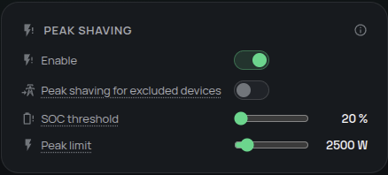

# Reserva potencia de batería para picos de demanda

El peak shaving (protección de capacidad) convierte la batería en una reserva: por debajo de un umbral de estado de carga (SOC), deja de cubrir el consumo ordinario y solo cubre la carga que supera tu **Máximo de importación de red**. Así conserva energía para las cargas grandes que llevarían el contador por encima del tope.

## ¿Lo necesito?

**Úsalo si** tu tarifa penaliza picos de importación altos, tu instalación tiene un techo práctico de importación o el seguimiento normal del hogar vacía la batería antes del periodo en que aparecen cargas grandes.

**No lo necesitas si** quieres que la batería cubra la demanda ordinaria del hogar hasta su SOC mínimo normal.

El **Máximo de importación de red** funciona sin peak shaving y siempre está activo: la carga desde red se mantiene por debajo, y cuando algo llevaría el contador por encima (un [dispositivo excluido](../configuration/excluded-devices.md) que el controlador no ve, o un objetivo de red fijado por encima) la batería cubre el exceso. El peak shaving solo añade el comportamiento de reserva por debajo del umbral de SOC.

## Antes de empezar

- Confirma que **Consumo de la casa** y la importación de red tienen el signo correcto y siguen las cargas reales.
- Configura el **Máximo de importación de red** con el nivel de importación por encima del cual debe intervenir la batería (ver abajo).
- Elige el SOC de batería por debajo del cual debe detenerse la descarga ordinaria.

## Máximo de importación de red

Un único ajuste (`number.<prefijo>_max_contracted_power`, siempre presente; `500–20,000 W`) es el techo de la importación de red. Se aplica todo el día, con cualquier SOC, con o sin peak shaving:

- La carga desde red se mantiene por debajo. En modo manual esto vale para las baterías cuya potencia manual envía Omnibattery (Zendure, Anker y otros drivers sin registros de potencia de carga): su carga manual se reduce y una descarga manual nunca se fuerza. Una Marstek en modo manual sigue sus propios registros y no se limita.
- Cuando algo llevaría el contador por encima, la batería cubre el exceso.
- Es un techo, no un objetivo: si la batería ya cubre toda la casa, no cambia nada.
- Gana al precio y al horario: por encima del techo la batería descarga aunque el control de descarga por precio, una retención del plan de Precio dinámico, una franja sin descarga, una retención de la carga semanal o la pausa de un cargador de coche la tuvieran quieta. Nunca salta el SOC mínimo, la temperatura, una batería desconectada, los límites por fase, el interruptor **Permitir Descarga** de la propia batería ni la reserva de la predescarga inteligente.

Es el mejor esfuerzo, no una garantía. Si la casa consume 8 kW, el tope es 5,75 kW y la batería entrega 2,5 kW, el contador se pasa igualmente. Cuando ocurre, **Reducción de Picos Activa** lo muestra en sus atributos (`grid_import_cap_active`, `cap_requested_w`: lo que la batería tenía que dar, `cap_delivered_w`: lo que dio) y el registro anota un aviso por episodio cuando el contador lleva 30 segundos por encima del techo.

## Ventana de 15 minutos

Algunas tarifas de capacidad facturan la importación media de cada cuarto de hora, no cada instante. El interruptor **Ventana de 15 min de Importación de Red** (`switch.<prefijo>_grid_import_window_15min`, siempre presente) hace que el Máximo de importación de red funcione así.

- **Apagado** (instantáneo): el tope limita cada instante. Úsalo cuando el tope protege un magnetotérmico; en España, pasarse de la potencia contratada hace saltar el ICP. Es el valor predeterminado en todas partes salvo Bélgica.
- **Encendido**: el tope limita la importación media de red de cada cuarto del reloj local (:00, :15, :30, :45). Viene encendido por defecto en Bélgica si nunca lo has configurado; el valor predeterminado sale del ajuste de país de Home Assistant.

Omnibattery mide el cuarto por sí mismo a partir del sensor de red que ya lee, así que ese sensor debe ser el contador de facturación (P1/DSMR). Solo cuenta la importación; la exportación no la descuenta.

En la práctica:

- Un hervidor justo al empezar un cuarto se recorta como en el modo instantáneo.
- Un hervidor tras varios minutos tranquilos se deja pasar, porque el cuarto aún tiene presupuesto.
- Tras un pico grande que la batería no pudo cubrir, la importación se reduce durante el resto del cuarto para compensar.

Nunca deja pasar un pico antes de tiempo apostando a que la carga bajará después.

Salvaguardas:

- A menos de 30 segundos de un cambio de cuarto, el tope nunca supera el valor configurado, porque el reloj del contador puede ir unos segundos desfasado.
- Tras un reinicio o recarga, un hueco en el sensor de red, o una muestra que cruza un cambio de cuarto durante más de 30 segundos, el cuarto no se considera fiable: se aplica el tope instantáneo hasta que empiece el siguiente cuarto.
- La carga desde red nunca supera el Máximo de importación de red, sea cual sea el presupuesto que quede en el cuarto. El planificador de carga predictiva siempre planifica con el valor configurado.
- Cuando se agota el presupuesto de un cuarto, la batería cubre toda la casa (si nada físico se lo impide) y la carga desde red se detiene hasta que termina el cuarto. Se registra un aviso por cada cuarto cuyo presupuesto se supera.

**Reducción de Picos Activa** gana tres atributos: `window_valid` (el cuarto es fiable), `window_import_kwh` (importación acumulada en este cuarto) y `window_cap_w` (importación permitida durante el resto del cuarto).

## Cómo activarlo

1. Abre el panel lateral de Omnibattery y selecciona **Control**.
2. Activa **Peak Shaving**.
3. Configura **Umbral de SOC de Peak Shaving**. Por debajo de este SOC medio de flota, la batería guarda su reserva para las cargas que superan el Máximo de importación de red.
4. Opcional: activa **Peak Shaving para dispositivos excluidos**. Solo importa dentro de una franja de carga predictiva; fuera de ella, los dispositivos excluidos siempre se cubren por encima del tope.

| Ajuste | Predeterminado | Rango |
|---|---:|---:|
| **Umbral de SOC de Peak Shaving** | `30%` | `20–100%` |
| **Máximo de importación de red** | tu potencia contratada | `500–20,000 W` |

{ width="650" style="display: block; margin: 0 auto;"}

## Qué verás

Por encima del umbral de SOC, continúa el seguimiento normal del hogar. Por debajo:

- La demanda igual o inferior al Máximo de importación de red se queda en la red para que la batería conserve su reserva.
- La demanda superior se cubre solo con la cantidad necesaria para devolver la importación hacia el tope.
- El excedente solar aún puede cargar la batería.

Por ejemplo, con un Máximo de importación de red de `3,000 W` y `4,500 W` de demanda del hogar, la batería suministra `1,500 W` y la red `3,000 W`. Con `2,000 W` de demanda, la batería permanece inactiva.

**Peak Shaving activo** y el estado de integración distinguen entre recortar un pico, conservar capacidad, cargar con excedente y permanecer inactivo. Un enfriamiento de relé configurado puede mantener brevemente la potencia mínima de batería después de que el controlador pida inactividad; es protección esperada del relé, no una nueva decisión de carga o descarga.

{ width="650" style="display: block; margin: 0 auto;"}

Consulta la [cronología diaria de funcionamiento](daily-operation-timeline.md) para comparar las acciones de peak shaving con la demanda del hogar, y la [carga predictiva](../configuration/predictive-charging/index.md#demanda-de-la-vivienda-durante-una-franja-de-carga) para la secuencia de protección de importación durante un periodo de carga.

## Si no funciona

| Síntoma | Causa probable | Qué comprobar |
|---|---|---|
| La batería sigue cubriendo demanda ordinaria | El SOC medio de batería está por encima del umbral de conservación | **Umbral de SOC de Peak Shaving** y **Peak Shaving activo** |
| Un pico permanece por encima del Máximo de importación de red | La potencia de descarga disponible o alguna regla de seguridad limita la salida | SOC mínimo, disponibilidad de batería, límites de fase, estado de respaldo y límites de potencia |
| No se cubre una carga excluida dentro de una franja predictiva | La opción de dispositivos excluidos está desactivada | **Peak Shaving para dispositivos excluidos** |
| La batería no pasa a inactividad inmediatamente | El enfriamiento de relé mantiene potencia mínima o la telemetría se está estabilizando | Enfriamiento de relé PD y potencia instantánea de batería |
| Se pausa la carga predictiva desde red | La importación del hogar alcanzó el techo aplicable | Estado de carga predictiva y **Máximo de importación de red** |
| La batería descarga durante un periodo protegido por precio | Tiene prioridad un pico físico por encima del Máximo de importación de red | Importación de red y estado de protección activo |

??? "Detalles avanzados"
    Por debajo del umbral de conservación, Omnibattery reconstruye la carga del hogar a partir de telemetría de CA de red y batería y aplica este objetivo:

    ```text
    battery_discharge = max(0, household_load - max_grid_import)
    ```

    El SOC medio excluye baterías no disponibles y controladas manualmente. Siguen aplicándose SOC mínimo, disponibilidad, control manual o por franja, restricciones de respaldo, protección de fase y límites de potencia de batería/sistema.

    **Peak Shaving para dispositivos excluidos** está desactivado de forma predeterminada y solo importa dentro de una franja de carga predictiva; en cualquier otro momento el Máximo de importación de red ya cubre los dispositivos excluidos. Con `1,000 W` de demanda normal, `4,000 W` excluidos y un tope de `3,000 W`, la batería suministra `2,000 W`: `1,000 W` para demanda normal y `1,000 W` para cubrir el exceso de la carga excluida.

    Durante un periodo activo de carga predictiva, la demanda del hogar tiene prioridad. Omnibattery reduce primero la carga positiva de batería, después ordena inactividad y espera a que se estabilice la telemetría de inversor y medidor. Si la importación sigue demasiado alta, la importación física por encima del Máximo de importación de red activa descarga de emergencia, también para cargas excluidas que vea la conexión de red.

    Las restricciones de descarga basadas en precio y los periodos protegidos de precio negativo no pueden suprimir una orden legítima de emergencia del Máximo de importación de red. Detener la carga predictiva, la descarga por Máximo de importación de red, la descarga normal proporcional–derivativa (PD) y la descarga de emergencia siguen siendo acciones independientes. Cuando vuelve capacidad de importación estable, la descarga se detiene, la telemetría se estabiliza y la carga predictiva se reanuda con histéresis; se conservan su objetivo de SOC y energía pendiente.

    El enfriamiento de relé es opcional y por defecto es `0 seconds`. Cuando se configura, una solicitud de activo a inactivo puede mantener la dirección ya activa a la potencia mínima configurada, o `100 W` si no se establece mínimo, hasta que vence el enfriamiento seleccionado. Un gran desequilibrio evita esta retención. Protege el relé de ciclos rápidos de apagado/encendido y no retrasa cambios directos de dirección entre carga y descarga.

## Qué cambia al actualizar

El Máximo de importación de red sustituye a dos ajustes que significaban casi lo mismo: **Potencia máxima contratada** (solo frenaba la carga desde red) y el **Límite de pico** del peak shaving (solo hacía descargar la batería, y solo por debajo del umbral de SOC).

1. **Desaparece el "Límite de pico".** La migración es automática: con Peak Shaving activado, el tope pasa a ser el menor de los dos números; con él desactivado, la potencia contratada. Revisa el valor tras actualizar: el número más bajo implica más uso de batería.
2. **Vuelve a importar el blueprint Peak Shaving Limit Sync** y elige de nuevo la entidad Máximo de importación de red; la antigua ya no existe. Consulta [Blueprints](../automations/blueprints.md#sincronizacion-del-limite-de-peak-shaving).
3. **El tope ahora está siempre activo.** Si tu potencia contratada se quedó en el valor predeterminado de `7,000 W` y no es correcto para tu casa, ajústala.
4. **Se rompen las configuraciones de "solo picos".** Si usabas un límite de pico inferior a la potencia contratada (umbral de SOC al `100%` más un límite menor, como en las incidencias #523 y #843), "solo picos por encima de 2,000 W" ahora significa fijar el propio Máximo de importación de red en `2,000 W`, lo que también limita la carga desde red a `2,000 W`.
5. **En Bélgica la ventana de 15 minutos viene activada.** Si el país de Home Assistant es Bélgica y nunca has tocado el interruptor, **Ventana de 15 min de Importación de Red** arranca activado; apágalo para el techo instantáneo. Consulta [Ventana de 15 minutos](#ventana-de-15-minutos).
