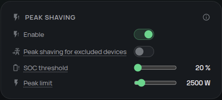

# Reserve battery power for demand peaks

Peak shaving (capacity protection) turns the battery into a reserve: below a battery state of charge (SOC) threshold, it stops covering ordinary consumption and only covers the load above your **Maximum grid import**. That keeps energy for the large loads that would push the meter over the cap.

## Do I need it?

**Use it if** your tariff penalizes high import peaks, your installation has a practical import ceiling, or normal household tracking empties the battery before the period when large loads appear.

**You do not need it if** you want the battery to cover ordinary household demand down to its normal minimum SOC.

**Maximum grid import** works without peak shaving and is always on: grid charging stays under it, and when something would take the meter over it (an [excluded device](../configuration/excluded-devices.md) the controller does not see, or a grid target set above it) the battery covers the excess. Peak shaving only adds the reserve behaviour below the SOC threshold.

## Before you start

- Confirm that **Home Consumption** and grid import have the correct sign and follow real loads.
- Set **Maximum grid import** to the import level above which the battery should intervene (see below).
- Choose the battery SOC below which ordinary discharge should stop.

## Maximum grid import

One setting (`number.<prefix>_max_contracted_power`, always present; `500–20,000 W`) is the ceiling for grid import. It applies all day, at any SOC, with or without peak shaving:

- Grid charging stays under it. In manual mode this covers the batteries whose manual power Omnibattery sends (Zendure, Anker and other drivers without charge-power registers): their manual charge is reduced, and a manual discharge is never forced. A Marstek in manual mode follows its own registers and is not limited.
- When something would take the meter over it, the battery covers the excess.
- It is a ceiling, not a target: when the battery already covers the whole house, nothing changes.
- It wins over price and schedule: above the cap the battery discharges even when Price-Based Discharge Control, a hold of the Dynamic Pricing plan, a no-discharge time slot, a weekly charge hold or an EV charger pause would keep it idle. It never overrides minimum SOC, temperature, an offline battery, phase limits, the battery's own **Allow Discharge** switch or the Smart Pre-Discharge reserve.

This is best effort, not a guarantee. If the house draws 8 kW, the cap is 5.75 kW and the battery delivers 2.5 kW, the meter still goes over. When that happens, **Peak Shaving Active** shows it in its attributes (`grid_import_cap_active`, `cap_requested_w`: what the battery had to deliver, `cap_delivered_w`: what it delivered) and the log gets one warning per episode once the meter stays above the cap for 30 seconds.

## 15-minute window

Some capacity tariffs bill the average import of each quarter hour, not every instant. The switch **Grid Import 15-min Window** (`switch.<prefix>_grid_import_window_15min`, always present) makes the Maximum grid import work that way.

- **Off** (instantaneous): the cap limits every instant. Use this when the cap protects a breaker; in Spain, going over the contracted power trips the ICP. It is the default everywhere except Belgium.
- **On**: the cap limits the average grid import of each quarter of the local clock (:00, :15, :30, :45). It is on by default in Belgium when you never set it; the default comes from Home Assistant's country setting.

Omnibattery measures the quarter itself from the grid sensor it already reads, so that sensor must be the billing meter (P1/DSMR). Only import counts; export does not discount it.

In practice:

- A kettle right at the start of a quarter is shaved as in the instantaneous mode.
- A kettle after several quiet minutes is left alone, because the quarter still has budget.
- After a big spike the battery could not cover, import is pulled down for the rest of the quarter to compensate.

It never lets a spike through early betting that the load will drop later.

Safeguards:

- Within 30 seconds of a quarter boundary the cap never goes above the configured value, because the meter's clock may be a few seconds off.
- After a restart or reload, a gap in the grid sensor, or a sample that straddles a boundary for more than 30 seconds, the quarter is not trusted: the instantaneous cap applies until the next quarter starts.
- Grid charging never goes above the Maximum grid import, whatever budget the quarter has left. The predictive charging planner always plans with the configured value.
- When a quarter's budget is spent, the battery covers the whole house (if nothing physical stops it) and grid charging stops until the quarter ends. One warning is logged per quarter whose budget is exceeded.

**Peak Shaving Active** gains three attributes: `window_valid` (the quarter is trusted), `window_import_kwh` (import so far this quarter) and `window_cap_w` (import allowed for the rest of the quarter).

## How to enable it

1. Open the Omnibattery sidebar panel and select **Control**.
2. Turn on **Peak Shaving**.
3. Set **Peak Shaving SOC Threshold**. Below this average fleet SOC, the battery keeps its reserve for loads above the Maximum grid import.

| Setting | Default | Range |
|---|---:|---:|
| **Peak Shaving SOC Threshold** | `30%` | `20–100%` |
| **Maximum grid import** | your contracted power | `500–20,000 W` |

{ width="650" style="display: block; margin: 0 auto;"}

## What you will see

Above the SOC threshold, normal household tracking continues. Below it:

- Demand at or below the Maximum grid import stays on the grid so the battery preserves its reserve.
- Demand above it is covered only by the amount needed to bring import back toward the cap.
- Solar surplus can still charge the battery.

For example, with a `3,000 W` Maximum grid import and `4,500 W` of household demand, the battery supplies `1,500 W` and the grid supplies `3,000 W`. At `2,000 W` of demand, the battery remains idle.

**Peak Shaving Active** and the integration status distinguish shaving a peak, conserving capacity, charging from surplus, and idle operation. A configured relay cooldown may briefly hold minimum battery power after the controller asks for idle; this is expected relay protection rather than a new charge or discharge decision.

{ width="650" style="display: block; margin: 0 auto;"}

See the [daily operation timeline](daily-operation-timeline.md) to compare peak-shaving actions with household demand, and [predictive charging](../configuration/predictive-charging/index.md#household-demand-during-a-charging-slot) for the import-protection sequence during a charging period.

## If it does not work

| Symptom | Likely cause | What to check |
|---|---|---|
| The battery still covers ordinary demand | Average battery SOC is above the conservation threshold | **Peak Shaving SOC Threshold** and **Peak Shaving Active** |
| A peak remains above the Maximum grid import | Available battery discharge power or another safety rule is limiting output | Minimum SOC, battery availability, phase limits, backup state, and power limits |
| The battery does not fall to idle immediately | Relay cooldown is holding minimum power or telemetry is settling | PD relay cooldown and live battery power |
| Predictive grid charging pauses | Household import reached the applicable ceiling | Predictive charging status and **Maximum grid import** |
| The battery discharges during a price-protected period | A physical peak above the Maximum grid import takes priority | Grid import and the active protection status |

??? "Advanced details"
    Below the conservation threshold, Omnibattery reconstructs household load from grid and battery AC telemetry and applies this target:

    ```text
    battery_discharge = max(0, household_load - max_grid_import)
    ```

    The average SOC excludes unavailable and manually controlled batteries. Minimum SOC, battery availability, manual or time-slot control, backup restrictions, phase protection, and battery/system power limits still apply.

    The Maximum grid import always counts excluded devices. With `1,000 W` of normal demand, `4,000 W` excluded, and a `3,000 W` cap, the battery supplies `2,000 W`: `1,000 W` for normal demand and `1,000 W` to cover the excess of the excluded load.

    During an active predictive charging period, household demand has priority. Omnibattery first reduces positive battery charging, then commands idle and waits for inverter and meter telemetry to settle. If import remains too high, physical import above the Maximum grid import triggers emergency discharge, including for excluded loads seen by the grid connection.

    Price-based discharge restrictions and protected negative-price periods cannot suppress a legitimate Maximum grid import emergency command. Stopping predictive charge, Maximum grid import discharge, normal proportional–derivative (PD) discharge, and emergency discharge remain separate actions. When stable import capacity returns, discharge stops, telemetry settles, and predictive charging resumes with hysteresis; its SOC target and pending energy remain preserved.

    Relay cooldown is optional and defaults to `0 seconds`. When configured, an active-to-idle request can hold the already active direction at the configured minimum power, or `100 W` when no minimum is set, until the selected cooldown expires. A large imbalance bypasses the hold. This protects the relay from rapid off/on cycling and does not delay direct charge-to-discharge direction changes.

## What changes when you upgrade

Maximum grid import replaces two settings that meant almost the same thing: **Max contracted power** (it only slowed grid charging) and Peak Shaving's **Peak limit** (it only made the battery discharge, and only below the SOC threshold).

1. **Peak limit disappears.** Migration is automatic: with Peak Shaving on, the cap becomes the lower of the two numbers; with it off, the contracted power. Check the value after upgrading: the lower number means more battery use.
2. **Re-import the Peak Shaving Limit Sync blueprint** and pick the Maximum grid import entity again; the old entity no longer exists. See [Blueprints](../automations/blueprints.md#peak-shaving-limit-sync).
3. **The cap is now always on.** If your contracted power was left at the `7,000 W` default and that is wrong for your home, set it correctly.
4. **"Peaks only" setups break.** If you used a peak limit lower than the contracted power (SOC threshold at `100%` plus a lower limit, as in issues #523 and #843), "peaks only above 2,000 W" now means setting Maximum grid import itself to `2,000 W`, which also caps grid charging to `2,000 W`.
5. **In Belgium the 15-minute window is on by default.** If Home Assistant's country is set to Belgium and you never touched the switch, **Grid Import 15-min Window** starts on; turn it off for the instantaneous cap. See [15-minute window](#15-minute-window).
